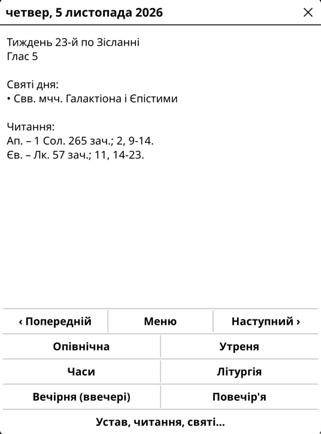
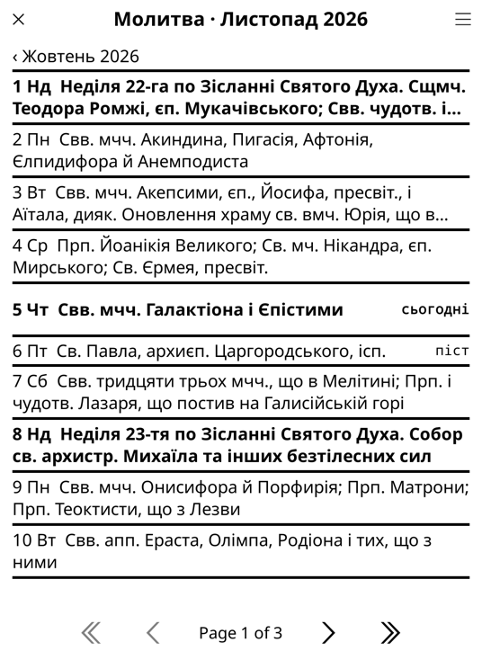
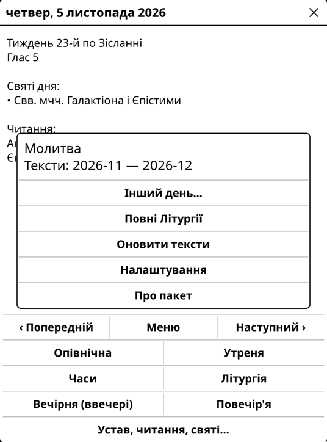

# Молитва для KOReader

Плагін [KOReader](https://koreader.rocks) для щоденних богослужінь УГКЦ на e-reader: календар місяця,
екран дня (глас, піст, свята), Вечірня, Утреня, Літургія, читання.

Тексти богослужінь **не входять до плагіна**. На вашу команду плагін завантажує їх через Wi-Fi з
«Молитви Церкви» ([prayer-service.pp.ua](https://prayer-service.pp.ua), А. Мартинишин) і збирає пакет
прямо на пристрої. Тексти належать їхнім авторам і використовуються з дозволу автора проєкту.
**Комерційне використання текстів «Молитви Церкви» заборонено**; ліцензія коду (AGPL) на них не поширюється.

Kobo Clara BW, KOReader v2026.07.1.

## Де працює

На будь-якій читалці чи пристрої з [KOReader](https://koreader.rocks): Kobo, Kindle (з джейлбрейком),
PocketBook, Android (зокрема Onyx Boox), reMarkable, Cervantes, Linux і macOS.

- Перевірено на **Kobo Clara BW** з KOReader **v2026.07.1**. На інших пристроях плагін має працювати,
  бо використовує лише стандартні модулі KOReader, але ще не перевірявся. Якщо щось не так, напишіть в Issues.
- Потрібна свіжа версія KOReader (рекомендовано v2026.07 або новіша): старі збірки можуть не мати модуля
  розпакування архівів, і тоді «Оновити тексти» не спрацює.
- Пункт «Молитва» в головному меню пристрою є лише на Kobo (через NickelMenu). На інших пристроях
  плагін відкривається з меню KOReader.

## Встановлення

0. Якщо KOReader ще немає, встановіть його за офіційною інструкцією для свого пристрою:
   [Kobo](https://github.com/koreader/koreader/wiki/Installation-on-Kobo-devices),
   [Kindle](https://github.com/koreader/koreader/wiki/Installation-on-Kindle-devices),
   [PocketBook](https://github.com/koreader/koreader/wiki/Installation-on-PocketBook-devices),
   Android ([F-Droid](https://f-droid.org/packages/org.koreader.launcher.fdroid/) або
   [GitHub Releases](https://github.com/koreader/koreader/releases)), інші — на [koreader.rocks](https://koreader.rocks).
1. Завантажте `molytva.koplugin-<версія>.zip` зі сторінки Releases.
2. Підключіть пристрій до комп'ютера через USB (на Android можна скопіювати файл будь-яким способом)
   і розпакуйте архів у теку `plugins` KOReader, щоб вийшло `plugins/molytva.koplugin/main.lua`:
   - Kobo: `.adds/koreader/plugins/`
   - Kindle: `koreader/plugins/`
   - PocketBook: `applications/koreader/plugins/`
   - Android: `koreader/plugins/` у внутрішній пам'яті
   - Інші: тека `plugins` поруч із `koreader.sh` / `reader.lua` у теці KOReader
3. Перезапустіть KOReader і відкрийте **Молитва → Налаштування**: виберіть календар
   (новоюліанський для України або григоріанський для діаспори) і кількість місяців.
4. Увімкніть Wi-Fi і натисніть **Молитва → Оновити тексти**.

На macOS після копіювання приберіть службові файли: `find /Volumes/KOBOeReader/.adds -name '._*' -delete`.

### Пункт «Молитва» в меню Kobo (необов'язково)

Якщо встановлено [NickelMenu](https://pgaskin.net/NickelMenu/), скопіюйте
[`nickelmenu/molytva`](nickelmenu/molytva) у `.adds/nm/molytva`. У головному меню Kobo з'явиться
пункт «Молитва», який запускає KOReader одразу з календарем.

Докладніше про роботу плагіна: [`molytva.koplugin/README.md`](molytva.koplugin/README.md).

## English

A KOReader plugin for daily UGCC (Ukrainian Greek Catholic Church) services: month calendar,
day screen (tone, fasting, feasts), Vespers, Matins, Divine Liturgy and readings. Service texts are
not bundled: on request the plugin downloads them over Wi-Fi from «Молитва Церкви»
(prayer-service.pp.ua) and builds a pack on the device. The texts are used with the author's
permission; **commercial use of the texts is prohibited**. Install by extracting the release ZIP into
KOReader's `plugins` folder; see the steps above. Works on any device that runs a recent KOReader
(Kobo, Kindle, PocketBook, Android, reMarkable, desktop); tested so far on Kobo Clara BW with KOReader v2026.07.1.

## Розробка

Тести: `bash tests/run.sh` (Lua 5.1, шлях задають `LUA_BIN` / `LUAC_BIN`) і `pytest -q tests`.
Зібрати ZIP для релізу: `tools/make_release.sh`.

## Ліцензія

Код: [AGPL-3.0-only](LICENSE), як і в KOReader. Ліцензія не поширюється на тексти богослужінь.
